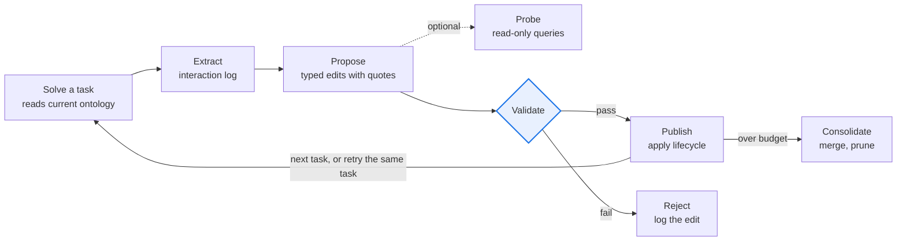

# Ontology RSI Toolkit

- Feature Name: `ontology-rsi-toolkit`
- Start Date: 2026-11-11
- Quest: RSI-Q008, [penguin-harness-community#37](https://github.com/Prism-Shadow/penguin-harness-community/issues/37)
- Author: EonHao
- Status: draft, for maintainer review

[中文版](DESIGN.zh.md)

## Summary
[summary]: #summary

Training tasks and test tasks share a domain, not a task. Self-evolution should therefore learn a model of that domain. This proposal is an RSI toolkit that keeps a typed domain ontology for an agent and refines it from the agent's own Traces.

An ontology has six element kinds:
- entity types
- relations
- state lifecycles
- source precedence
- action contracts
- constraints

Every element must cite text that appears verbatim in a Trace. Elements move through a `candidate → active → retired` lifecycle driven by counted support and counterexamples.

The ontology is stored in a learning slot of the Target's Agent State, the same mechanism the ACE and AWM toolkits use. The package ships no domain content.

Validation runs on GDPevo-essential with DeepSeek-V4.1-Flash-1017, under the protocol of the existing leaderboard entries. The evaluation tests five stated hypotheses, not only the mean score.

## Motivation
[motivation]: #motivation

### What transfers from a training task to a test task

GDPevo-essential pairs each training task with a test task of the same kind. `train-00k` and `test-00k` differ only in entities, dates or jurisdictions. `test-005` often combines earlier kinds:
- In Financial Control, it combines reimbursement exposure with prepaid-to-GL variance.
- In Service Ticket Resolution, it audits proposed updates against the same status, routing and evidence rules.

The two splits share the domain:
- the record types;
- how records link and change state;
- which source is authoritative;
- which decisions are allowed under which conditions.

Instance values do not carry over. Anything a learner stores beyond the domain cannot help on the test split, and it can hurt.

### Where current learners lose this

The four published methods learn free-text rules or Skills, and they keep an edit when the training score rises. This has two consequences.

**An edit mixes domain knowledge with instance coincidence.** The training score cannot tell the two apart, because both raise it.

**The training score saturates.** The judge returns one number per task, and each group has five training tasks. Five of the 24 recorded training runs end at exactly 100. From that point on, the score carries no information, but the rule set can keep changing.

The PR #16 records show the result. Each value is a mean over the six groups.

| Method | Test mean | Final training mean | Train − test gap | Gain on case 005 | Gain on cases 001–004 | Test cases below baseline |
| --- | --- | --- | --- | --- | --- | --- |
| SkillAdam | 68.95 | 90.0–100 | 27.8 | +6.6 | +14.1 | 6 of 30 |
| SkillOpt | 70.25 | 95.1–100 | 27.4 | +2.0 | +16.9 | 5 of 30 |
| TRACE | 68.02 | 80.6–94.3 | 18.3 | +7.3 | +12.8 | 8 of 30 |
| OpenSkill | 62.16 | 46.8–88.1 | 14.7 | −1.0 | +7.5 | 10 of 30 |

Training means are measured inside the training session with the judge available, so the gap is not a clean measure of overfitting. The last three columns use the test protocol only, and they show the same pattern:
- Gains shrink on the composite case.
- Every method scores below the baseline on 5 to 10 of the 30 test cases.
  - On Court Clerk case 001, all four methods do.
  - On Financial Control case 005, SkillOpt loses 31.7 points.

The [GDPevo report](https://penguin.ooo/blog/gdpevo-self-evolution) traces one instance of this to its rules. In Court Clerk Operations, later SkillAdam edits added "Delay contract cases 14d & skip Fridays". This is a coincidence of five training tasks, written as policy.

### What a typed domain model changes

1. **It separates domain from instance by construction.** Knowledge attaches to a type, such as `E.Claim` or `A.approve_payment`. Validate rejects any edit that names an instance or a case. A coincidence can enter only as a claim about a type, and then it has to survive point 2.
2. **It makes evidence countable.** When two tasks support the same rule, they produce two `SUPPORT` operations on the same id. Support and counterexamples become exact counts. No embedding model is needed, and no validation split, which GDPevo does not have.
3. **It takes supervision from observations as well as scores.** Every tool output is an observation of the domain: a schema, a status, a link. Structure that is observed directly is accepted after one observation. Only inferred policy waits for scores and repeated support. Because GDPevo services are read-only, a query can test a hypothesis without affecting the task. Observations say what the domain is; scores say whether a decision was right.
4. **It composes.** A task that combines two earlier kinds needs the entities and contracts of both, and a typed model returns them by lookup. A workflow learned for each kind separately does not compose this way.
5. **It turns policy into a check.** Contracts give the agent a checklist to run before it submits. Checking a decision against an explicit rule is usually an easier task for a model than producing the right decision under an unstated one. The audit task in Service Ticket Resolution `test-005` is such a check.

The evaluation states each of these as a hypothesis and tests it (*Hypotheses* below).

### Fit with the roadmap

Stage 1 of the community roadmap evolves the harness and leaves model weights fixed. It favours artifacts that people can read, audit and roll back, and that transfer across models. A typed ontology is the most structured artifact of this kind, because a script can check every element. The toolkit contributes to two Stage 1 tracks:
- **Framework**: a new toolkit.
- **Data**: six GDPevo-essential entries in the RFC-0002 format.

Judging by the catalog summaries, none of the 131 methods in Awesome RSI learns an action model of the precondition-and-effect kind. The closest, EvoOntology, needs a validation split.

## Guide-level explanation
[guide-level-explanation]: #guide-level-explanation

The toolkit is installed on the agent that runs the experiment. It then appears under **Method** in the Optimize tab of the Evaluation Center, next to the other toolkits. It can also be started from a prompt:

```text
Use the `ontology-rsi-toolkit` Skill to train agent `reviewer` on Benchmark
`gdpevo-essential-coverage-review-train`, then measure the frozen ontology on
`gdpevo-essential-coverage-review-test`.
```

The Skill follows the same sequence as the other toolkits:
1. Initialize the learning slot in the Target.
2. Measure H1.
3. Run the refinement loop over the training cases.
4. Freeze the ontology.
5. Measure it on the test Benchmark.

After training, the Target's State contains `skills/domain-ontology/`. The Target reads a rendered view, `ONTOLOGY.md`, before its first substantive action. An excerpt (the content is learned, not shipped):

```markdown
## Actions
### A.approve_payment · active · support 3
Params: claim: E.Claim
Requires: claim.status == approved; no linked E.Bill is void or has a cleared E.Payment
Evidence to fetch: E.Bill, E.Payment

## Precedence
### P.current_over_export · candidate · support 1 · verify against data first
Current clinical records (documents.is_current = true) override the stale export.
```

Phase 2 adds two parts for agents that work outside benchmarks:
- a `skills/ontology` Skill for everyday modelling;
- two hooks, described below.

## Reference-level explanation
[reference-level-explanation]: #reference-level-explanation

### Constraints from the current codebase

| # | Fact | Source | Consequence |
| --- | --- | --- | --- |
| 1 | The `penguin` block in `package.json`, as described in community RFC-0003, is no longer read. There is no fallback. | `penguin-harness/rfcs/PRFC-0003-plugin.md` v1.1.0 (2026-11-04) | The package declares its content with `@Component({contributes})` in `src/index.ts`, and the build emits `ifaces.json`. Community RFC-0003 is out of date. |
| 2 | `penguin-harness-plugins` is an index. Each entry is a `manifest.toml` that points to an npm package or a GitHub Release tarball. | That repository's `README.md` and `CONTRIBUTING.md` | The source needs its own home. See *Delivery*. |
| 3 | All 12 GDPevo-essential task groups declare `state_mode: read_only`. | `task_group.yaml` in each group of `penguin-harness-benchmark` | On GDPevo, contracts constrain the decisions written into the answer, not tool calls that change state. |
| 4 | A Harbor test loads only the frozen `skill/` folder and one reader line. | Benchmark `README.md`; `skilladam-rsi-toolkit` `initialization.md` | The ontology ships as files inside `skill/`. The validation path does not depend on hooks. |
| 5 | Reinstalling a plugin replaces `skills/<name>/` entirely. A confining sandbox blocks writes to Agent State. | Docs: *Skills › Installation and storage*; *Settings › Sandbox* | Learned data lives in a slot owned by the Target. A write that fails is staged in the scratchpad. |

### Ontology model

`ontology.json` is the single source of truth. The toolkit renders `ONTOLOGY.md` from it for the model to read. The file is JSON rather than YAML because hook and Skill scripts may use only Node built-ins, and Node has no built-in YAML parser.

| Kind | Holds | Example from GDPevo |
| --- | --- | --- |
| `entity` | Fields, key, enums, and the endpoint or table where instances live | Record types of each group's business service |
| `relation` | Foreign keys and cardinality | claim → bill → payment (Financial Control) |
| `lifecycle` | Legal state transitions | Claim, bill and payment statuses |
| `precedence` | Which source wins when two sources disagree | `basis_audit.source_precedence` (Coverage Review); book of record versus a stale worksheet (Portfolio Management) |
| `action` | Parameter types, preconditions, effects, required evidence, gate order, failure signatures | Gate order and action choice (Service Ticket Resolution) |
| `constraint` | Invariants such as reconciliations, thresholds and effective dates, each with a scope | Fee rules scoped by jurisdiction (Court Clerk Operations) |

Every element carries these fields:
- `id`: stable, never reused
- `kind`
- `scope`
- `status`: `candidate`, `active` or `retired`
- `support`: the number of distinct tasks that support the element
- `evidence`: a list of `{session, quote}` pairs
- `counterexamples`

```json
{
  "id": "A.approve_payment",
  "kind": "action",
  "params": { "claim": "E.Claim" },
  "preconditions": [
    "claim.status == approved",
    "no linked E.Bill is void or has a cleared E.Payment"
  ],
  "effects": ["claim enters the payable set"],
  "requires_evidence": ["E.Bill", "E.Payment"],
  "scope": "global",
  "status": "candidate",
  "support": 1,
  "evidence": [{ "session": "<session id>", "quote": "<verbatim tool output>" }],
  "counterexamples": []
}
```

`ONTOLOGY.md` starts with a token budget of 6,000. When the budget is exceeded, the consolidation step runs.

### Learning slot and runtime use

Initialization creates `skills/domain-ontology/` in the Target's State, with four files:
- `SKILL.md`
- `ontology.json`
- `ONTOLOGY.md`
- `CHANGELOG.md`

It also appends one fixed reader line to the Target's `AGENTS.md`, the same way `ace-rsi-toolkit` sets up `ace-playbook`.

During a task, the Target:
1. reads `SKILL.md` and `ONTOLOGY.md` before its first substantive action;
2. looks up records through the endpoints and tables named in `entity` elements, and resolves conflicting sources with `precedence` elements;
3. before submitting, checks every business decision in its answer against the preconditions and required evidence of the matching `action` element;
4. writes the ids of the elements it relied on to `ontology-used.txt` in its scratchpad, so that they can be credited later.

`ONTOLOGY.md` marks `candidate` elements as unconfirmed. The Target must check them against data before relying on them.

Phase 2 adds two hooks. Neither is on the GDPevo validation path.
- **`stop`**: when a task ends, hands a condensed Trace to a background subagent that refines the ontology. It follows the same pattern as `continual-learning`.
- **`pre_tool_use`**: checks action contracts in environments that can be written to.
  - In the default observe mode, it only records.
  - In checkpoint mode, it denies the first call that violates a contract and states the reason. An identical retry is allowed through, so a wrong contract cannot block the agent.

### Refinement loop

The ontology is updated after every task. An edit is published only if it quotes the Trace verbatim and passes deterministic validation.



1. **Extract** (script): pulls tool calls, outputs, errors and fetched records from the Trace. During training, it also attaches the per-case score that the judge returns.
2. **Propose** (an LLM in the Ontologist role): returns typed edit operations: `ADD`, `REFINE`, `SCOPE`, `MERGE`, `RETIRE` and `SUPPORT`. Every operation must quote the Trace.
3. **Probe** (optional): sends read-only queries to the business service to test a hypothesis.
4. **Validate** (script): checks
   - the schema;
   - referential integrity;
   - that each quote appears verbatim in the Trace;
   - that no instance or case ids appear;
   - the token budget.
5. **Publish**: applies the lifecycle rules below and updates support using `ontology-used.txt` and the score. It then bumps the Skill and State versions, takes a snapshot and appends to `CHANGELOG.md`.
6. **Consolidate**: when the budget is exceeded, merges synonymous elements and drops the lowest-support candidates.

| Origin | Initial status | Promoted to `active` when | On a counterexample |
| --- | --- | --- | --- |
| Structure observed directly in data: fields, foreign keys, enums | `active` | — | Corrected or retired |
| Policy inferred from scores: thresholds, precedence, gate order | `candidate` | Supported by at least 2 distinct tasks, or a retry of the same task scores higher | Scope narrowed; retired if the scope cannot be narrowed |

### Package layout

```text
ontology-rsi-toolkit/
├── package.json                      # npm fields only
├── src/index.ts                      # card, skills and hooks contributions; build emits ifaces.json
├── icon.svg
├── skills/ontology-rsi-toolkit/      # experiment controller, named after the plugin
│   ├── SKILL.md
│   ├── references/initialization.md  # creates the slot and the reader line
│   ├── references/evaluation.md      # byte-identical to the shared toolkit reference
│   ├── references/training.md        # in-container continuous training (Harbor)
│   ├── references/ontologist.md      # the Propose role
│   └── scripts/onto.mjs              # Node built-ins only: validate, render, apply, extract, checklist, diff
├── skills/ontology/                  # phase 2: everyday modelling for any agent
└── hooks/                            # phase 2: stop.mjs, pre_tool_use.mjs
```

The card has category `rsi` and `preinstall: false`. Under PRFC-0019, the name and category are enough for the toolkit to appear in the Method dropdown and in the algorithm count on the draft page. No frontend change is needed.

### Evaluation on GDPevo-essential

The current best average is SkillOpt's 70.25, against a baseline of 56.32.

| Group | Baseline | Best so far | Expected fit | Why |
| --- | --- | --- | --- | --- |
| Service Ticket Resolution | 48.90 | 69.95 (SkillOpt) | High | Gate order and action preconditions are action contracts; `test-005` is an audit. |
| Financial Control | 50.96 | 63.89 (SkillAdam) | High | Claim, bill and payment lifecycles; referential integrity |
| Portfolio Management | 70.16 | 77.40 (SkillOpt) | Low to medium | The bottleneck is arithmetic and route choice, and the policies are already explicit. |
| Coverage Review | 55.00 | 80.67 (SkillAdam) | High | The baseline scores exactly 55.00 on every case; `basis_audit` asks for source precedence and record order. |
| Court Clerk Operations | 52.60 | 61.98 (SkillOpt) | Medium | Rules scoped by jurisdiction; every method regresses on case 001. |
| Engineering Portfolio Analytics | 60.32 | 91.52 (TRACE) | Medium | Good structural fit, but little headroom is left. |

All scores are means of three test repetitions, taken from `penguin-harness-benchmark/experiments/gdpevo-essential/` (PR #16).

#### Hypotheses

The mean score shows whether the toolkit helps. The five hypotheses below show whether it helps for the reason the Motivation gives. Each one has a reference value from PR #16 and a stated consequence if it fails.

| # | Hypothesis | Measure | Reference (PR #16) | If it fails |
| --- | --- | --- | --- | --- |
| H1 | Domain knowledge transfers with less loss. | Train − test gap | 14.7–27.8 | Typed knowledge overfits the same way rules do; tighten the lifecycle thresholds. |
| H2 | Typed knowledge composes. | Gain on case 005 ÷ gain on cases 001–004 | −0.13 (OpenSkill) to 0.57 (TRACE) | Composition is not what types buy; drop the claim. |
| H3 | Gating limits harm. | Test cases below baseline | 5–10 of 30 | Candidate status does not stop harmful knowledge; gate candidates out of the rendered view. |
| H4 | Gains follow domain structure. | Gains in Coverage Review, Financial Control and Service Ticket Resolution exceed the gain in Portfolio Management. | — | The gain comes from something other than the model of the domain. |
| H5 | Types matter. | Typed ontology versus free-text notes under the same loop (ablation) | — | The gain comes from evidence gating alone; ship the loop and drop the types. |

There are 30 test cases and 3 repetitions. Results are reported as per-case paired differences against the baseline, with bootstrap intervals. H2 rests on six composite cases, so it is indicative rather than conclusive.

#### Protocol

- **Configuration**: DeepSeek-V4.1-Flash-1017 with thinking at max, on PenguinHarness 0.2.19. This matches PR #16.
- **Training**: one container and one session per group, with a 6-hour budget. The five training tasks run in order, and the judge is available. The ontology is refined after each task, and `skill/` is exported at the end.
- **Test**: `skill/` is frozen. Each case runs in a fresh container with the judge disabled, and the test is repeated three times.
- **Reported**:
  - the mean and sample standard deviation, per group and overall;
  - H1–H5;
  - training and test cost and tokens;
  - which elements the Target used, taken from `ontology-used.txt`.
- **Cost**: about US$11–14 for six trainings and 3 × 30 test runs. A baseline rerun adds about US$7.5, and the H5 ablation about US$12. These are estimated from the existing records at DeepSeek Flash list prices.

The results are submitted as six experiments under `experiments/gdpevo-essential/`, following RFC-0002.

### Awesome RSI classification

`experiment.yaml` records:

```yaml
dimensions:
  artifact: [Non-parametric, Context, Memory]
  mode: [Offline, Online]          # Offline on GDPevo; Online through the phase 2 stop hook
  topology: [Sequential]
  selection: [Artifact validation, Instance result]
  updater: [Teacher]               # the Ontologist runs as a separate role
  source: [Train/dev set, Environment]
  feedback: [Score, Non-binary, Non-score, Other]
  frequency: [Trajectory]
  scope: [Specialized]
```

## Invariants
[invariants]: #invariants

### Evidence-bound elements

> Every element that is not `retired` cites at least one quote that appears verbatim in a Trace of the Target.

Validate enforces this on every publish. Without it, the ontology cannot be audited, and a hallucinating Ontologist can write rules that look like facts.

### No private scoring material

> Nothing taken from a `rubric/`, a gold answer or a verifier's private output enters the refinement loop. The only score signal is the per-case score that the judge returns.

This is the information barrier that every toolkit keeps (*Self-Improvement › The information barrier*). If it is broken, the test scores mean nothing.

### Data-free package

> The published package contains no domain ontology content. Every element in a learning slot was produced by the loop from that agent's own runs.

This is the separation of algorithm and data that community RFC-0003 asks for. Without it, the toolkit would carry benchmark knowledge, and its scores would not transfer.

## Drawbacks
[drawbacks]: #drawbacks

- `ONTOLOGY.md` adds up to about 6k tokens of context to every task.
- Extraction quality depends on the model. Candidate status limits the effect of wrong elements but does not remove them.
- GDPevo services are read-only, so the benchmark does not measure the `pre_tool_use` contract check.
- Each group has five training tasks. The support threshold of 2 is a starting value, to be checked in the smoke run.
- Under delivery option A, the source lives outside the community repositories.

## Rationale and alternatives
[rationale-and-alternatives]: #rationale-and-alternatives

- **Free-text notes instead of typed elements.** This is what ACE and the Skill-based toolkits do. H5 measures the difference directly.
- **Selecting each edit on a validation split**, as EvoOntology does. GDPevo has no validation split. SkillOpt uses Train for selection as a declared adaptation, which runs into the saturation described in *Motivation*. Counted support and counterexamples do not need a validation split.
- **YAML storage.** YAML is easier to read, but hook scripts cannot parse it without a dependency. The rendered `ONTOLOGY.md` covers readability.
- **Two plugins**: an `rsi` toolkit plus a product plugin for everyday modelling. One package is simpler to install. It can be split if the maintainers want the `rsi` category to hold only algorithm toolkits.
- **Delivery.**

| Option | How | For | Against |
| --- | --- | --- | --- |
| A: independent repository plus index entry (proposed) | Source in the contributor's GitHub repository; a GitHub Release carries the `npm pack` tarball; a `manifest.toml` entry is added to `penguin-harness-plugins` | Matches the index's CONTRIBUTING; the author owns releases | Source outside the community repositories; releases depend on the contributor |
| B: built-in plugin | PR to `penguin-harness/plugins/ontology-rsi-toolkit/` | Sits with the nine existing toolkits, under core's tests | The quest names `penguin-harness-plugins` as the target; the maintainers must accept a new built-in |
| C: source directory in `penguin-harness-plugins` | `<plugin-id>/` at the repository root, as community RFC-0003 describes | Matches the RFC text | The harness no longer reads this format, and it conflicts with the index design |

## Prior art
[prior-art]: #prior-art

| Method | Learned artifact | Retention | Difference |
| --- | --- | --- | --- |
| [ACE](https://arxiv.org/abs/2510.04618) | Playbook of itemized rules | Append-only, with helpful and harmful counters | Free text, not tied to entities, no evidence required |
| [SkillOpt](https://arxiv.org/abs/2605.23904), [TRACE](https://arxiv.org/abs/2608.22793) | Skill or Skill bank | Selection by training score | As above |
| [EvoOntology](https://arxiv.org/abs/2609.15779) | Ontology layer of a data agent: content, schema, tool interfaces | One edit at a time, compared pairwise on validation tasks | Needs a validation split; no explicit action contracts or lifecycles |
| [EvoBelief](https://arxiv.org/abs/2610.12789) | Falsifiable world-model rules | Independent validation before use; counterexamples narrow or retire rules | Same lifecycle idea, applied here to a typed business ontology |
| [TTSE](https://arxiv.org/abs/2609.24289) | Separate FACT and TIP banks | Batch failure attribution; misleading rules retired | Already ablated on GDPevo; its FACT/TIP split is the closest precedent for separating observed structure from inferred policy |
| [HarnessMM](https://arxiv.org/abs/2610.32813) | Executable decision graphs with guards | Validation selects the configuration | Aims at token cost, not domain modelling |

This comparison is based on the abstracts. The full texts of EvoOntology, EvoBelief and TTSE will be reviewed in P0, and this section will be updated before the PR. [#36](https://github.com/Prism-Shadow/penguin-harness-community/issues/36), the Knowledge Base plugin, covers documents and retrieval; this toolkit covers types and contracts.

## Unresolved questions
[unresolved-questions]: #unresolved-questions

1. Delivery: option A, B or C?
2. Should community RFC-0003 be updated to match PRFC-0003 v1.1.0? A revision PR can come with this work.
3. Evaluation settings:
   - Which benchmark commit? The baseline ran at `53f779e8` and SkillOpt at `457400e8`, while the current statements pin `010fda6b`.
   - Which model-name spelling: `DeepSeek-V4.1-Flash-1017` (published records) or `deepseek-flash-1017` (RFC-0002 example)?
   - Which thinking level: `max` (published records) or `high` (workflow guide)?
4. Should the PR #16 baseline be reused, or rerun at the chosen commit?
5. Is `ontology-rsi-toolkit`, in the `rsi` category, the right name and place?
6. Are the phase 2 hooks in scope for #37, or should they be a separate quest?

## Future possibilities
[future-possibilities]: #future-possibilities

- **Stage 2.** Typed contracts linked to evidence could act as checks when filtering synthesized trajectories, and as verifiable reward terms for agentic RL. The Stage 2 roadmap names both.
- **Workbench.** An Ontology Explorer workbench could show the graph and its changelog next to the chat.
- **Shared ontologies.** One ontology could be shared by the agents of a Project. This relates to penguin-harness#308 (project-level shared Skills).
- **Writable benchmarks.** A benchmark with writable business services would make the `pre_tool_use` checkpoint measurable.

## Schedule
[schedule]: #schedule

| Phase | Work | Dates (2026) |
| --- | --- | --- |
| P0 | Settle the open questions; read EvoOntology, EvoBelief and TTSE in full | 11/12–11/15 |
| P1 | Model, scripts, slot, training reference, controller | 11/16–11/23 |
| P1 | Smoke run on one group (Coverage Review or Financial Control); results posted to #37 | 11/24–11/26 |
| P1 | Full run on all six groups | 11/27–12/03 |
| P2 | Hooks and the everyday Skill, in parallel with the full run | 11/30–12/06 |
| P3 | H5 ablation | 12/04–12/09 |
| — | PR submitted | 12/07 |
| — | Claim grace period ends | 12/11 |
