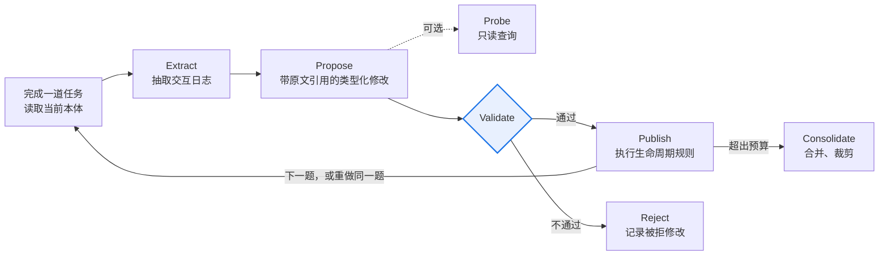

# Ontology RSI Toolkit

- Feature Name: `ontology-rsi-toolkit`
- Start Date: 2026-11-11
- Quest: RSI-Q008，[penguin-harness-community#37](https://github.com/Prism-Shadow/penguin-harness-community/issues/37)
- Author: EonHao
- Status: 草案，待维护者评审

[English](DESIGN.md)

## Summary
[summary]: #summary

训练任务与测试任务之间共享的是领域，不是任务本身，所以自进化应当学习的是对这个领域的建模。本提案提出一个 RSI 工具包：为 Agent 维护一份带类型的领域本体，并根据 Agent 自己的 Trace 持续精炼。

本体由六类元素组成：实体类型、关系、状态生命周期、来源优先级、动作契约和约束。每个元素都必须引用一段能在 Trace 中逐字找到的原文。元素按 `candidate → active → retired` 的生命周期演进，推进的依据是计数得到的支持数和反例。

本体存放在被测 Agent 的 Agent State 学习槽中，机制与 ACE、AWM 工具包相同。插件包本身不包含任何领域内容。

验证在 GDPevo-essential 上进行，模型为 DeepSeek-V4.1-Flash-1017，实验口径与现有榜单一致。评估除了看均分，还逐一检验预先写明的五个假设。

## Motivation
[motivation]: #motivation

### 从训练题能迁移到测试题的是什么

GDPevo-essential 中，每道训练题都有一道同类的测试题与之配对：`train-00k` 和 `test-00k` 只在实体、日期或司法辖区上不同；`test-005` 往往是前面几类题的组合。例如，Financial Control 的 `test-005` 要求把报销敞口和预付账款与总账的差异合在一起分析；Service Ticket Resolution 的 `test-005` 则要求按同样的状态、路由和证据规则，审核别人提交的更新。

训练集和测试集共享的是领域：有哪些记录类型，记录之间怎样关联、怎样变更状态，以哪个来源为准，什么条件下允许做什么决策。具体实例的取值不会迁移。学习器在领域之外存下的任何东西，都帮不了测试题，反而可能拖累测试题。

### 现有学习器在哪里丢掉了这一点

已发布的四个方法学到的都是自由文本规则或 Skill，并且以训练分数上升作为保留修改的依据，这带来两个后果。

第一，一次修改里混着领域知识和实例巧合，训练分数分不开二者，因为两者都能让分数上升。

第二，训练分数会饱和。judge 每道题只返回一个分数，每组只有五道训练题。已记录的 24 次训练中，有 5 次的最终训练均分正好是 100。到了这一步，分数已经不再提供任何信息，规则集却还可以继续改。

PR #16 的数据印证了这两点。下表中的数值均为 6 组的平均：

| 方法 | 测试均分 | 最终训练均分 | 训练 − 测试差距 | case 005 上的提升 | case 001–004 上的提升 | 低于基线的测试题 |
| --- | --- | --- | --- | --- | --- | --- |
| SkillAdam | 68.95 | 90.0–100 | 27.8 | +6.6 | +14.1 | 30 道中 6 道 |
| SkillOpt | 70.25 | 95.1–100 | 27.4 | +2.0 | +16.9 | 30 道中 5 道 |
| TRACE | 68.02 | 80.6–94.3 | 18.3 | +7.3 | +12.8 | 30 道中 8 道 |
| OpenSkill | 62.16 | 46.8–88.1 | 14.7 | −1.0 | +7.5 | 30 道中 10 道 |

训练均分是在训练会话内、judge 可用的条件下测得的，所以训练与测试的差距并不能单纯看作过拟合程度。但后三列只用测试协议测量，呈现的是同一个规律：在组合题上，提升明显缩小；每个方法都会让 30 道测试题中的 5 到 10 道低于基线。Court Clerk 的 case 001，四个方法全部低于基线；Financial Control 的 case 005，SkillOpt 掉了 31.7 分。

[GDPevo 实验报告](https://penguin.ooo/blog/gdpevo-self-evolution) 把其中一例追溯到了具体规则：在 Court Clerk Operations 上，SkillAdam 后期的修改写进了 "Delay contract cases 14d & skip Fridays"。这只是五道训练题碰巧呈现的共性，却被写成了规则。

### 带类型的领域模型改变了什么

1. **从结构上把领域和实例分开。** 知识只能挂在某个类型上，例如 `E.Claim`、`A.approve_payment`；修改中只要出现实例或案例的 id，就会被 Validate 拒绝。巧合要想进入本体，只能以“关于某个类型的断言”出现，并且还要通过第 2 点的检验。
2. **让证据可以计数。** 两道题支持同一条规则，就是对同一个 id 执行两次 `SUPPORT` 操作。支持数和反例因此都是精确的计数，既不需要 embedding 模型，也不需要验证集，而 GDPevo 恰好没有验证集。
3. **监督信号不只来自分数，也来自观察。** 每一次工具输出都是对领域的一次观察：一个 schema、一个状态、一条关联。直接观察到的结构，观察一次即可采纳；只有推断出来的策略，才需要等待分数和重复的支持。GDPevo 的业务服务是只读的，验证假设时发一条查询即可，不会影响任务本身。观察回答的是“领域是什么样的”，分数回答的是“这个决策对不对”。
4. **可以组合。** 一道组合了两类题的任务，需要的是两类题各自涉及的实体和契约之和。在类型化模型里，这只是一次查找；而按题型分别学到的工作流，无法这样直接组合。
5. **把策略变成检查。** 契约给 Agent 提供了一份提交前的检查清单。对模型来说，对照明确的规则检查一个决策，通常比在规则没有说出口的情况下直接做出正确决策更容易。Service Ticket Resolution 的 `test-005`（审核更新）本身就是这样一次检查。

评估部分把以上每一点都写成假设并加以检验，见下文 *Hypotheses*。

### 与路线图的关系

社区路线图的 Stage 1 只进化 Harness，模型权重保持不变。它偏好可读、可审计、可回滚、能在不同模型之间迁移的产物，而带类型的本体是这类产物里结构化程度最高的一种：每个元素都可以用脚本校验。本工具包对应 Stage 1 的两条主线：Framework 方面，提供一个新工具包；Data 方面，按 RFC-0002 格式提交 6 条 GDPevo-essential 实验记录。

从 catalog 中的简介来看，Awesome RSI 收录的 131 个方法里，没有一个学习“前置条件 + 效果”形式的动作模型。最接近的 EvoOntology 依赖验证集。

## Guide-level explanation
[guide-level-explanation]: #guide-level-explanation

把本工具包安装在负责运行实验的 Agent 上之后，它会和其他工具包一起出现在评估中心 Optimize 页的 **Method** 下拉框中。也可以直接用提示词启动：

```text
Use the `ontology-rsi-toolkit` Skill to train agent `reviewer` on Benchmark
`gdpevo-essential-coverage-review-train`, then measure the frozen ontology on
`gdpevo-essential-coverage-review-test`.
```

Skill 的执行流程与其他工具包一致：

1. 在被测 Agent 中初始化学习槽；
2. 测量 H1；
3. 在训练题上运行精炼循环；
4. 冻结本体；
5. 在测试集上测量。

训练结束后，被测 Agent 的 State 中会多出 `skills/domain-ontology/`。被测 Agent 在第一次做实质操作之前，会先读渲染出来的 `ONTOLOGY.md`。下面是一段示例，内容是训练中学到的，并非插件自带：

```markdown
## Actions
### A.approve_payment · active · support 3
Params: claim: E.Claim
Requires: claim.status == approved; no linked E.Bill is void or has a cleared E.Payment
Evidence to fetch: E.Bill, E.Payment

## Precedence
### P.current_over_export · candidate · support 1 · verify against data first
Current clinical records (documents.is_current = true) override the stale export.
```

第二阶段会增加日常建模用的 `skills/ontology` Skill，以及两个用于 benchmark 之外场景的 Hook，详见下文。

## Reference-level explanation
[reference-level-explanation]: #reference-level-explanation

### 现有代码带来的约束

| # | 事实 | 依据 | 影响 |
| --- | --- | --- | --- |
| 1 | 社区 RFC-0003 所述的 `package.json` 中的 `penguin` 块已不再被读取，也没有兼容逻辑。 | `penguin-harness/rfcs/PRFC-0003-plugin.md` v1.1.0（2026-11-04） | 改为在 `src/index.ts` 中用 `@Component({contributes})` 声明，构建时生成 `ifaces.json`。社区 RFC-0003 已经过时。 |
| 2 | `penguin-harness-plugins` 是一个索引仓库，每个条目是一个 `manifest.toml`，指向一个 npm 包或一个 GitHub Release 压缩包。 | 该仓库的 `README.md`、`CONTRIBUTING.md` | 源码需要另外托管，见 *Delivery*。 |
| 3 | GDPevo-essential 的 12 个任务组全部声明了 `state_mode: read_only`。 | `penguin-harness-benchmark` 中各组的 `task_group.yaml` | 在 GDPevo 上，契约约束的是写进答案的业务决策，而不是会修改状态的工具调用。 |
| 4 | Harbor 测试只加载冻结的 `skill/` 目录和一行读取指令。 | benchmark 的 `README.md`；`skilladam-rsi-toolkit` 的 `initialization.md` | 本体以文件形式放在 `skill/` 中；验证流程不依赖 Hook。 |
| 5 | 重装插件会整体替换 `skills/<name>/`；开启限制性沙箱后，Agent 不能写自己的 Agent State。 | 文档 *Skills › Installation and storage*、*Settings › Sandbox* | 学到的数据放在被测 Agent 自己拥有的学习槽中；写入失败的改动先暂存在 scratchpad。 |

### 本体模型

`ontology.json` 是唯一的数据源，工具包由它渲染出 `ONTOLOGY.md` 供模型阅读。选用 JSON 而不是 YAML，是因为 Hook 和 Skill 脚本只能使用 Node 内置模块，而 Node 没有内置 YAML 解析器。

| 类别 | 内容 | GDPevo 中的例子 |
| --- | --- | --- |
| `entity` | 字段、主键、枚举值，以及实例所在的接口或数据表 | 各组业务服务中的记录类型 |
| `relation` | 外键与基数 | Financial Control 中的 claim → bill → payment |
| `lifecycle` | 合法的状态迁移 | claim、bill、payment 的状态 |
| `precedence` | 两个来源冲突时以哪个为准 | Coverage Review 中的 `basis_audit.source_precedence`；Portfolio Management 中权威账簿与过期工作表之间的取舍 |
| `action` | 参数类型、前置条件、效果、必需证据、门控顺序、失败特征 | Service Ticket Resolution 中的门控顺序与动作选择 |
| `constraint` | 对账、阈值、生效日期等不变量，每条都带适用范围 | Court Clerk Operations 中按司法辖区划分的费用规则 |

每个元素都带有以下字段：`id`（稳定且不复用）、`kind`、`scope`、`status`（`candidate`、`active` 或 `retired`）、`support`（支持该元素的不同任务数）、`evidence`（由 `{session, quote}` 组成的列表）和 `counterexamples`。

```json
{
  "id": "A.approve_payment",
  "kind": "action",
  "params": { "claim": "E.Claim" },
  "preconditions": [
    "claim.status == approved",
    "no linked E.Bill is void or has a cleared E.Payment"
  ],
  "effects": ["claim enters the payable set"],
  "requires_evidence": ["E.Bill", "E.Payment"],
  "scope": "global",
  "status": "candidate",
  "support": 1,
  "evidence": [{ "session": "<session id>", "quote": "<verbatim tool output>" }],
  "counterexamples": []
}
```

`ONTOLOGY.md` 的初始 token 预算为 6,000，超出后会触发整合步骤。

### 学习槽与运行时使用

初始化时，在被测 Agent 的 State 中创建 `skills/domain-ontology/` 目录，内含 `SKILL.md`、`ontology.json`、`ONTOLOGY.md` 和 `CHANGELOG.md` 四个文件，并在其 `AGENTS.md` 末尾追加一行固定的读取指令。这与 `ace-rsi-toolkit` 处理 `ace-playbook` 的方式相同。

执行任务时，被测 Agent 会依次：

1. 在第一次做实质操作之前，读取 `SKILL.md` 和 `ONTOLOGY.md`；
2. 按 `entity` 元素记录的接口或数据表查询记录，遇到来源冲突时按 `precedence` 元素处理；
3. 提交之前，把答案中的每个业务决策与对应 `action` 元素的前置条件和必需证据逐一核对；
4. 把用到的元素 id 写进 scratchpad 中的 `ontology-used.txt`，供事后归因。

`ONTOLOGY.md` 会把 `candidate` 元素标为“未确认”。被测 Agent 必须先用数据核实这些元素，才能据此做判断。

第二阶段增加两个 Hook，两者都不在 GDPevo 的验证流程中：

- **`stop`**：任务结束时，把压缩后的 Trace 交给一个后台子会话来精炼本体，做法与 `continual-learning` 相同。
- **`pre_tool_use`**：在可写的环境中检查动作契约。默认是观察模式，只记录、不拦截。切换到检查点模式后，第一次违反契约的调用会被拒绝，并附上理由；完全相同的调用再次发起时放行，避免一条错误的契约把 Agent 卡死。

### 精炼循环

每完成一道任务，本体就更新一次。只有逐字引用了 Trace 原文、并且通过确定性校验的修改，才会被发布。



1. **Extract**（脚本）：从 Trace 中抽出工具调用、输出、报错和查询到的记录。训练阶段还会附上 judge 返回的单题分数。
2. **Propose**（LLM 扮演 Ontologist 角色）：输出类型化的修改操作，包括 `ADD`、`REFINE`、`SCOPE`、`MERGE`、`RETIRE`、`SUPPORT`。每条操作都必须引用 Trace 原文。
3. **Probe**（可选）：向业务服务发送只读查询，验证某个假设。
4. **Validate**（脚本）：检查 schema 和引用完整性，确认每条引用都能在 Trace 中逐字找到、修改中不含实例或案例的 id、没有超出 token 预算。
5. **Publish**：按下表的生命周期规则合并修改，并根据 `ontology-used.txt` 和分数更新 support；随后提升 Skill 和 State 的版本号，打快照，并追加 `CHANGELOG.md`。
6. **Consolidate**：超出预算时，合并同义元素，删除 support 最低的候选元素。

| 来源 | 初始状态 | 升为 `active` 的条件 | 遇到反例时 |
| --- | --- | --- | --- |
| 直接从数据中观察到的结构：字段、外键、枚举值 | `active` | — | 修正或退役 |
| 从分数推断出的策略：阈值、优先级、门控顺序 | `candidate` | 得到至少 2 个不同任务的支持，或重做同一题后分数提高 | 收窄 scope；无法收窄则退役 |

### 包结构

```text
ontology-rsi-toolkit/
├── package.json                      # 只写 npm 字段
├── src/index.ts                      # 声明 card、skills、hooks；构建时生成 ifaces.json
├── icon.svg
├── skills/ontology-rsi-toolkit/      # 实验控制器，与插件同名
│   ├── SKILL.md
│   ├── references/initialization.md  # 创建学习槽和读取指令
│   ├── references/evaluation.md      # 与其他工具包共享的评估说明，逐字相同
│   ├── references/training.md        # 容器内连续训练（Harbor）
│   ├── references/ontologist.md      # Propose 角色说明
│   └── scripts/onto.mjs              # 只用 Node 内置模块：validate、render、apply、extract、checklist、diff
├── skills/ontology/                  # 第二阶段：供任意 Agent 使用的日常建模 Skill
└── hooks/                            # 第二阶段：stop.mjs、pre_tool_use.mjs
```

card 的类别为 `rsi`，`preinstall` 设为 `false`。按照 PRFC-0019，只要名称和类别符合约定，工具包就会自动出现在 Method 下拉框中，并计入首页的算法数量，无需改动前端。

### 在 GDPevo-essential 上的验证

目前平均分最高的是 SkillOpt，为 70.25；基线为 56.32。

| 任务组 | 基线 | 当前最好 | 预计契合度 | 原因 |
| --- | --- | --- | --- | --- |
| Service Ticket Resolution | 48.90 | 69.95（SkillOpt） | 高 | 门控顺序和动作前置条件本身就是动作契约；`test-005` 是一道审核题 |
| Financial Control | 50.96 | 63.89（SkillAdam） | 高 | claim、bill、payment 的生命周期；引用完整性 |
| Portfolio Management | 70.16 | 77.40（SkillOpt） | 低到中 | 瓶颈在计算和路由选择，相关政策已明确写出 |
| Coverage Review | 55.00 | 80.67（SkillAdam） | 高 | 基线在每道题上都恰好是 55.00 分；`basis_audit` 要求写出来源优先级和记录顺序 |
| Court Clerk Operations | 52.60 | 61.98（SkillOpt） | 中 | 规则按司法辖区划定适用范围；所有方法在 case 001 上都低于基线 |
| Engineering Portfolio Analytics | 60.32 | 91.52（TRACE） | 中 | 结构上契合，但剩余提升空间小 |

表中分数均为 3 次测试的均值，来自 `penguin-harness-benchmark/experiments/gdpevo-essential/`（PR #16）。

#### Hypotheses

均分只能说明本工具包有没有用；下面五个假设用来检验它是不是出于 Motivation 中所说的原因而有用。每个假设都给出了 PR #16 中的参照值，并写明假设不成立时得出什么结论。

| # | 假设 | 衡量方式 | 参照值（PR #16） | 若不成立 |
| --- | --- | --- | --- | --- |
| H1 | 领域知识迁移时损失更小 | 训练 − 测试差距 | 14.7–27.8 | 类型化知识和规则一样会过拟合；需要收紧生命周期阈值 |
| H2 | 类型化知识可以组合 | case 005 的提升 ÷ case 001–004 的提升 | −0.13（OpenSkill）到 0.57（TRACE） | 类型带来的好处不在组合能力上；撤回这一论断 |
| H3 | 门控能限制有害知识 | 低于基线的测试题数 | 30 道中 5–10 道 | candidate 状态挡不住有害知识；改为不在渲染视图中展示 candidate |
| H4 | 提升集中在结构性强的组 | Coverage Review、Financial Control、Service Ticket Resolution 的提升高于 Portfolio Management | — | 提升另有来源，并非来自对领域的建模 |
| H5 | 类型本身有作用 | 相同循环下，类型化本体对比自由文本笔记（消融实验） | — | 提升只来自证据门控；只保留循环，去掉类型 |

测试共 30 道题、重复 3 次，结果按题与基线做配对差值，并给出 bootstrap 区间。H2 只基于 6 道组合题，结论只能作为参考，不能视为定论。

#### Protocol

- **配置**：DeepSeek-V4.1-Flash-1017，thinking 设为 max，PenguinHarness 0.2.19，与 PR #16 一致。
- **训练**：每组一个容器、一个会话，时间预算 6 小时。5 道训练题按顺序完成，期间可以调用 judge。每做完一题精炼一次本体，最后导出 `skill/`。
- **测试**：冻结 `skill/`，每道题使用一个新容器，关闭 judge，重复 3 次。
- **报告**：每组及总体的均值和样本标准差；H1–H5 的结果；训练和测试的成本与 token 用量；根据 `ontology-used.txt` 统计被测 Agent 用到了哪些元素。
- **成本**：6 组训练加 3 × 30 次测试，约 11–14 美元；重跑基线约另加 7.5 美元，H5 消融约另加 12 美元。以上按现有实验记录和 DeepSeek Flash 的标价估算。

结果按 RFC-0002 的格式，作为 6 个实验提交到 `experiments/gdpevo-essential/`。

### Awesome RSI 分类

`experiment.yaml` 中记录：

```yaml
dimensions:
  artifact: [Non-parametric, Context, Memory]
  mode: [Offline, Online]          # GDPevo 上为 Offline；第二阶段的 stop hook 为 Online
  topology: [Sequential]
  selection: [Artifact validation, Instance result]
  updater: [Teacher]               # Ontologist 作为独立角色运行
  source: [Train/dev set, Environment]
  feedback: [Score, Non-binary, Non-score, Other]
  frequency: [Trajectory]
  scope: [Specialized]
```

## Invariants
[invariants]: #invariants

### Evidence-bound elements

> 每个未退役的元素都至少引用一段原文，且这段原文能在被测 Agent 的 Trace 中逐字找到。

Validate 在每次发布时都会检查这一点。没有这条约束，本体就无法审计，Ontologist 产生的幻觉也会被写成看起来像事实的规则。

### No private scoring material

> 任何来自 `rubric/`、标准答案或评测器私有输出的内容，都不会进入精炼循环；唯一的分数信号是 judge 返回的单题分数。

这是所有工具包都遵守的信息隔离原则（*Self-Improvement › The information barrier*）。一旦被打破，测试分数就失去了意义。

### Data-free package

> 发布的插件包不含任何领域本体内容；学习槽中的每个元素，都是精炼循环根据该 Agent 自身的运行记录生成的。

这正是社区 RFC-0003 要求的算法与数据解耦。没有这条约束，工具包就会夹带 benchmark 知识，测出的分数也不能代表它在其他场景下的表现。

## Drawbacks
[drawbacks]: #drawbacks

- `ONTOLOGY.md` 会让每个任务多出最多约 6k token 的上下文。
- 抽取质量取决于模型。candidate 状态能限制错误元素的影响，但不能完全消除。
- GDPevo 的业务服务是只读的，所以这个 benchmark 测不到 `pre_tool_use` 契约检查的效果。
- 每组只有 5 道训练题。support 阈值暂定为 2，需要在冒烟实验中验证是否合适。
- 如果交付采用方案 A，源码将位于社区仓库之外。

## Rationale and alternatives
[rationale-and-alternatives]: #rationale-and-alternatives

- **用自由文本笔记代替类型化元素。** 这是 ACE 和基于 Skill 的工具包的做法，H5 会直接测量两者的差别。
- **每次修改都用验证集筛选（EvoOntology 的做法）。** GDPevo 没有验证集。SkillOpt 在声明的适配中改用训练集做筛选，正好会遇到 Motivation 中描述的分数饱和问题。基于计数的 support 和反例不依赖验证集。
- **用 YAML 存储。** YAML 更易读，但 Hook 脚本必须引入外部依赖才能解析它。可读性已经由渲染出的 `ONTOLOGY.md` 解决。
- **拆成两个插件：** 一个 `rsi` 工具包，加一个日常建模用的产品插件。合成一个包，安装更简单；如果维护者希望 `rsi` 类别只放算法工具包，可以再拆开。
- **交付方式：**

| 方案 | 做法 | 优点 | 缺点 |
| --- | --- | --- | --- |
| A：独立仓库 + 索引条目（建议） | 源码放在贡献者的 GitHub 仓库，在 GitHub Release 中附上 `npm pack` 生成的压缩包，再向 `penguin-harness-plugins` 提交一个 `manifest.toml` 条目 | 符合索引仓库 CONTRIBUTING 的要求；作者自己负责发版 | 源码不在社区仓库中；发版依赖贡献者本人 |
| B：内置插件 | 向 `penguin-harness/plugins/ontology-rsi-toolkit/` 提交 PR | 与现有 9 个工具包放在一起，受 core 测试保护 | 任务指定的目标仓库是 `penguin-harness-plugins`；新增内置插件需要维护者同意 |
| C：把源码目录放进 `penguin-harness-plugins` | 按社区 RFC-0003 的描述，在仓库根目录建立 `<plugin-id>/` | 与 RFC 原文一致 | harness 已不再读取这种格式，而且与索引仓库的设计冲突 |

## Prior art
[prior-art]: #prior-art

| 方法 | 学到的产物 | 保留机制 | 区别 |
| --- | --- | --- | --- |
| [ACE](https://arxiv.org/abs/2510.04618) | 逐条列出规则的 playbook | 只增不删，记录 helpful / harmful 次数 | 自由文本，不关联实体，也不要求证据 |
| [SkillOpt](https://arxiv.org/abs/2605.23904)、[TRACE](https://arxiv.org/abs/2608.22793) | Skill 或 Skill 库 | 按训练分数筛选 | 同上 |
| [EvoOntology](https://arxiv.org/abs/2609.15779) | 数据 Agent 的本体层：内容、schema、工具接口 | 每次只改一处，在验证任务上成对比较 | 依赖验证集；没有显式的动作契约和生命周期 |
| [EvoBelief](https://arxiv.org/abs/2610.12789) | 可证伪的世界模型规则 | 经独立验证后才启用，遇到反例就收窄适用范围或退役 | 生命周期思路相同，本方案把它用于类型化的业务本体 |
| [TTSE](https://arxiv.org/abs/2609.24289) | 分开的 FACT 库与 TIP 库 | 按批次归因失败，退役有误导性的规则 | 已在 GDPevo 上做过消融；它把 FACT 和 TIP 分开，是“区分观察到的结构与推断出的策略”这一思路最接近的先例 |
| [HarnessMM](https://arxiv.org/abs/2610.32813) | 带守卫条件的可执行决策图 | 用验证集选择配置 | 目标是降低 token 成本，而不是领域建模 |

以上对比仅依据论文摘要。EvoOntology、EvoBelief、TTSE 三篇会在 P0 阶段精读全文，并在提交 PR 前更新本节。[#36](https://github.com/Prism-Shadow/penguin-harness-community/issues/36)（知识库插件）负责文档与检索，本工具包负责类型与契约。

## Unresolved questions
[unresolved-questions]: #unresolved-questions

1. 交付方式选 A、B 还是 C？
2. 社区 RFC-0003 是否要按 PRFC-0003 v1.1.0 更新？可以随本工作一并提交修订 PR。
3. 实验口径：
   - benchmark 用哪个 commit？基线跑在 `53f779e8` 上，SkillOpt 跑在 `457400e8` 上，而当前题面固定在 `010fda6b`。
   - 模型名写作 `DeepSeek-V4.1-Flash-1017`（已发布记录的写法），还是 `deepseek-flash-1017`（RFC-0002 示例的写法）？
   - thinking 用 `max`（已发布记录）还是 `high`（workflow 指南）？
4. 直接复用 PR #16 的基线，还是在选定的 commit 上重跑？
5. 名称 `ontology-rsi-toolkit` 和 `rsi` 类别是否合适？
6. 第二阶段的 Hook 是否属于 #37 的范围，还是另开任务？

## Future possibilities
[future-possibilities]: #future-possibilities

- **Stage 2**：关联了证据的类型化契约，可以在筛选合成轨迹时用作检查条件，也可以作为 agentic RL 中可验证的奖励项。Stage 2 路线图中都提到了这两个方向。
- **Workbench**：做一个 Ontology Explorer，在对话旁边浏览本体图谱和变更记录。
- **共享本体**：同一 Project 中的多个 Agent 共用一份本体，与 penguin-harness#308（项目级共享 Skill）相关。
- **可写的 benchmark**：如果有业务服务可写的 benchmark，就能测量 `pre_tool_use` 检查点的效果。

## Schedule
[schedule]: #schedule

| 阶段 | 工作内容 | 日期（2026） |
| --- | --- | --- |
| P0 | 确认待决问题；精读 EvoOntology、EvoBelief、TTSE 全文 | 11/12–11/15 |
| P1 | 本体模型、脚本、学习槽、训练参考文档、实验控制器 | 11/16–11/23 |
| P1 | 选一组做冒烟实验（Coverage Review 或 Financial Control），结果同步到 #37 | 11/24–11/26 |
| P1 | 6 组完整实验 | 11/27–12/03 |
| P2 | Hook 和日常建模 Skill，与完整实验并行 | 11/30–12/06 |
| P3 | H5 消融 | 12/04–12/09 |
| — | 提交 PR | 12/07 |
| — | 认领宽限期结束 | 12/11 |
